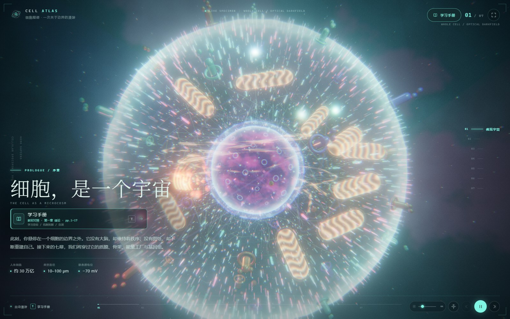
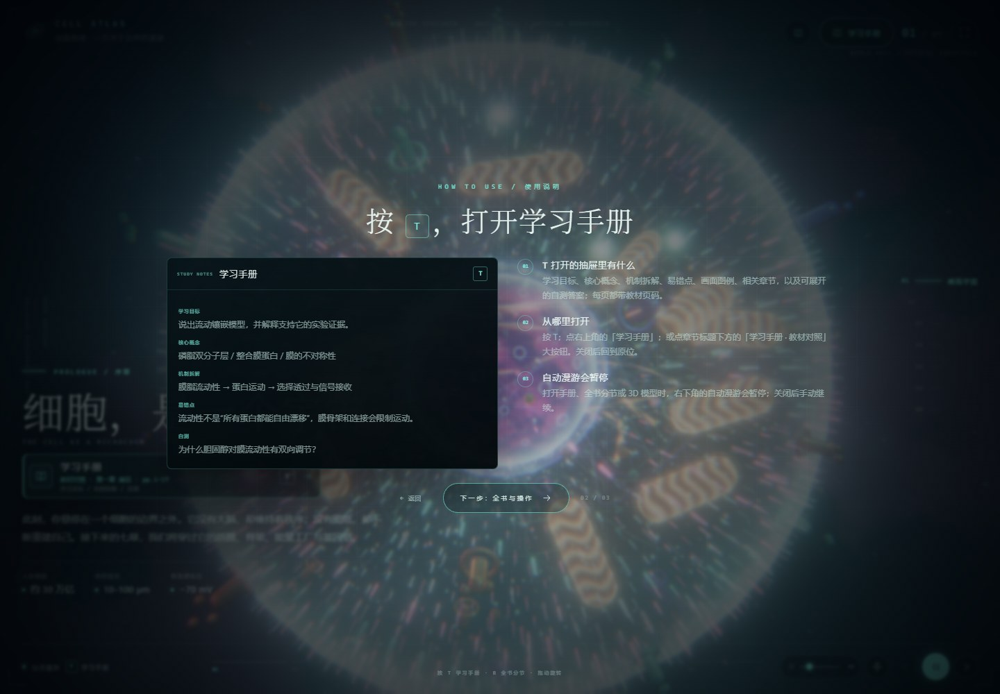
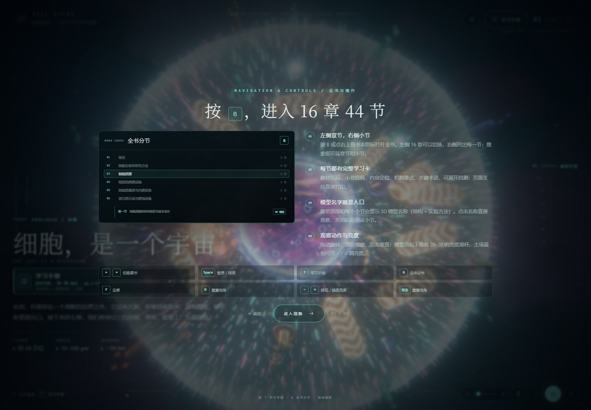
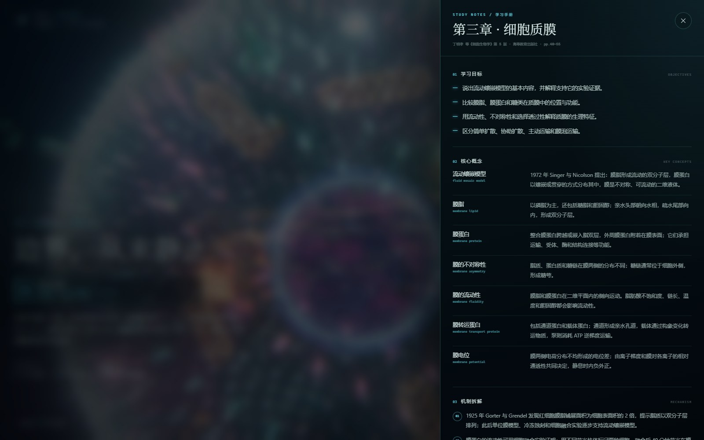
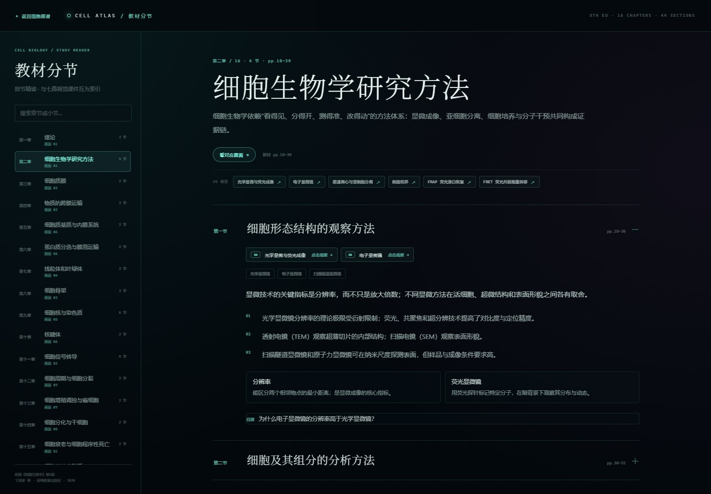
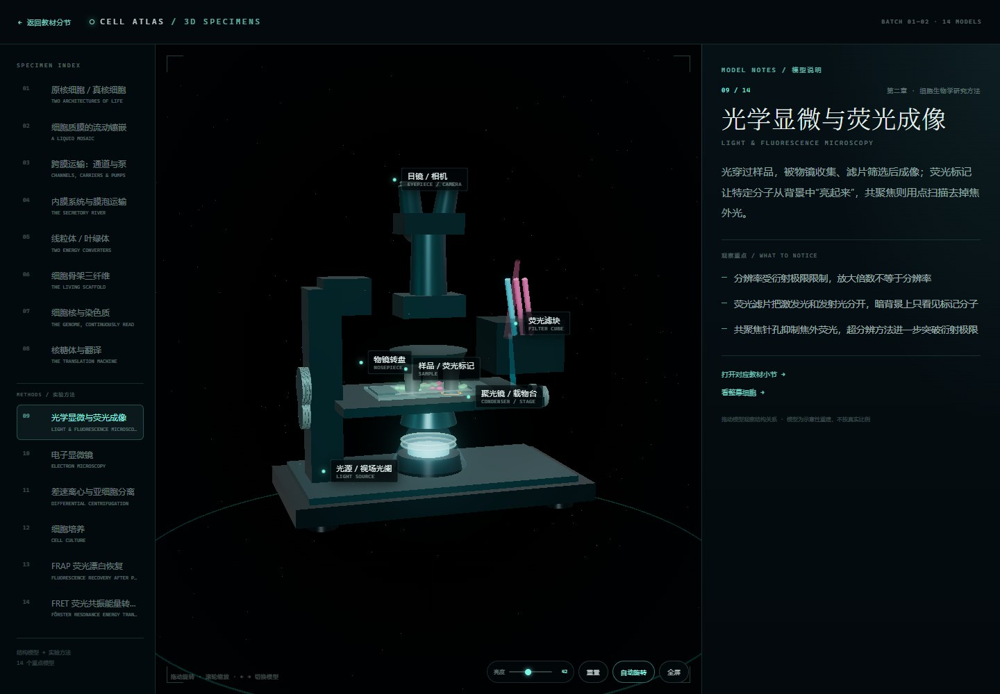

# Cell Atlas / 细胞图谱

> **在线体验**：[https://herryatlas.github.io/cell-atlas/](https://herryatlas.github.io/cell-atlas/) · [14 个 3D 模型](https://herryatlas.github.io/cell-atlas/models.html) · [教材分节](https://herryatlas.github.io/cell-atlas/textbook.html)
>
> **仓库**：[github.com/HerryAtlas/cell-atlas](https://github.com/HerryAtlas/cell-atlas) · **产品介绍**：[PDF](presentation/Cell-Atlas-产品介绍与未来构想.pdf) · **合作计划**：[PDF](presentation/Cell-Atlas-团队与算力合作计划书.pdf) · **多设备**：[HarmonyOS 工程](harmony/README.md)

**A cinematic, fully procedural Three.js cell biology courseware.**  
Seven movements, zero external textures or models, plus a **16-chapter / 44-section**
study library aligned with *Cell Biology* (5th ed., Higher Education Press, 2020).

[](https://threejs.org/)
[](#technical-notes)
[](LICENSE)
[](#run-the-demo)

<p align="center">
  <a href="media/cell-atlas-douyin-20s.mp4">
    
  </a>
  <br />
  <sub>点击画面观看 20 秒竖屏展示片 · Click the image to watch the 20s vertical cut</sub>
</p>

---

## What is this?

A cell is not a diagram. It is a luminous, moving, unstable architecture. Cell
Atlas turns the organelles, membranes and filaments of a eukaryotic cell into a
real-time WebGL world, then hangs a textbook study layer on top of it.

The project began as a **DSH Web UI plugin** and now also ships as a standalone
demo that runs on GitHub Pages. The visual engine is the same in both: the
standalone page is not a video or a mock-up.

- **Fully procedural** — icosahedral membrane, instanced phospholipids, flow
  particles, chromatin fibres, mitochondrial cristae, rough ER sheets, Golgi cisternae,
  lysosomes, spindle fibres and contractile-ring geometry are all generated in
  code.
- **All scenes refined** — the seven opening movements and fourteen section models
  share anatomical shape cues, with inward lipid tails, folded membrane sacs,
  fixed nuclear-pore scaffolds and a rotating ATP-synthase shaft. See
  [model improvements and teaching limits](MODEL-REALISM.md).
- **Custom GLSL** — noise displacement, Fresnel rims, liquid-crystal membrane
  veins, proton glow, volumetric shafts, film grain, chromatic aberration and a
  bespoke final grade.
- **Cinematic post** — `RenderPass → UnrealBloomPass → custom optical pass →
  OutputPass`, with radial focus falloff, vignette, grain and colour grading.
- **Textbook-aligned learning** — each movement has objectives, key concepts,
  mechanism notes, common traps, self-check questions, visual legend and exact
  textbook page references. A separate section reader covers **all 16 chapters
  and 44 sections** of the textbook, not only the seven visual movements.
- **Section-level study** — every section has its textbook subsection outline,
  a one-paragraph orientation, three mechanism points, key terms, and a hidden
  self-check answer. The reader works without WebGL and is printable.
- **Section 3D specimens** — fourteen focused procedural models: eight cell-
  structure specimens plus six experimental-method models (light/fluorescence
  microscopy, electron microscopy, centrifugation, cell culture, FRAP, FRET).
  They use projected anatomy labels and deep links from the reader.
  All fourteen specimens include the structural refinements documented in
  [MODEL-REALISM.md](MODEL-REALISM.md): molecular bilayers, membrane sacs,
  subunit geometry and instrument assembly. These remain teaching-scale
  reconstructions, not atomic structures or calibrated instrument simulations.
- **First-visit onboarding** — a four-page guide before entering the cell:
  welcome, a concrete mock of the **T** study drawer, a complete new-version
  usage guide (models, public guided lesson, completion conditions, restart and
  mobile rules), then **B** section navigation, model links, pointer controls
  and the full keyboard map.
  The plugin's help button reopens the usage page at any time.
- **No external assets** — no downloaded HDRIs, textures, 3D models or fonts.
  Three.js is bundled into the demo and the plugin client.

> 中文简介：一套完全程序化生成的电影级 Three.js 细胞生物学课件。从细胞质膜、
> 细胞骨架、线粒体、细胞核、内膜系统到有丝分裂的七幕漫游；每一幕配教材对照、
> 学习目标、核心概念、机制拆解、易错点和自测。另附 **16 章 · 44 节**的独立
> 分节学习页，按教材小节精读。既可作为 DSH 插件运行，也有无需安装的静态网页 Demo。
>
> **要把它发布到 GitHub？** 按 [GITHUB.md](GITHUB.md) 的步骤创建仓库并开启
> Pages；整个过程不需要改代码。

---

## Run the demo

The `docs/` folder is a prebuilt, self-contained static site. No build step is
needed just to look at it.

```bash
git clone https://github.com/HerryAtlas/cell-atlas.git
cd cell-atlas
python -m http.server 8000
# open http://localhost:8000/docs/
```

On Windows PowerShell the same command works if Python is on `PATH`. Any static
file server is fine; opening `docs/index.html` directly with `file://` also
works because the demo itself makes no application network requests. The
Netlify host may inject its own free-plan HUD script after load.

The full section reader is a second static page:

```text
http://localhost:8000/docs/textbook.html
```

The section 3D models are a third page:

```text
http://localhost:8000/docs/models.html
```

The guided **跨膜运输** sample lesson opens directly with:

```text
http://localhost:8000/docs/models.html?model=transport&learn=1
```

The detailed standalone usage page is:

```text
http://localhost:8000/docs/guide.html
```

All work independently of the WebGL courseware and can be bookmarked as daily
study pages. The current free deployment is GitHub Pages:

```text
https://herryatlas.github.io/cell-atlas/textbook.html
https://herryatlas.github.io/cell-atlas/models.html
https://herryatlas.github.io/cell-atlas/models.html?model=transport&learn=1
https://herryatlas.github.io/cell-atlas/guide.html
```

The old Netlify deployment remains online but production deploys are paused
while the team is on operating credits. GitHub Pages is the current public
entry; no paid upgrade is required.

### GitHub Pages

The repository already deploys `docs/` from `main`:

1. **Settings → Pages**
2. Source: **Deploy from a branch**
3. Branch: `main`, folder: **`/docs`**
4. Save. The demo is at
   `https://herryatlas.github.io/cell-atlas/`.

`docs/.nojekyll` is included, so the asset paths are served as-is.

A source push also runs
[`.github/workflows/sync-generated.yml`](.github/workflows/sync-generated.yml).
It rebuilds `docs/` and `client.js`, runs the unit tests, and commits the generated
files back to `main` when they changed. GitHub Pages then publishes the updated
`docs/` automatically; a source-only change does not leave the public site stale.

### First visit: four-page guide

The first visit opens with a four-page onboarding sequence before the cell
scene becomes interactive. It is deliberately not a modal tooltip: each page
shows the actual interface and explains one group of controls.

<p align="center">
  
</p>

<p align="center">
  
</p>

- **Page 01** — the welcome line “欢迎来到细胞的世界”, title, quick key map
  (`T` study notes, `B` section library, drag/wheel) and the entry into the guide.
- **Page 02** — a sample study drawer with 学习目标 / 核心概念 / 机制拆解 / 易错点 /
  自测, how to open it, the fact that auto-tour pauses, and the new
  **跨膜运输** guided lesson entry.
- **Page 03** — the detailed **新版使用说明** page: four stages, exact completion
  requirements, the ATP 0% / gradient 60% target experiment, free exploration,
  restart confirmation, mobile **看模型**, and a link to the standalone
  [full guide](docs/guide.html).
- **Page 04** — the **B** section-library mock, chapter/section navigation,
  model-name deep links (the transport model opens the guided lesson), drag/wheel/
  double-click behaviour, brightness, and a full key map
  (`←/→`, `Space`, `T`, `B`, `F`, `R`, `−/=`, double-click).
- Deep links from the reader or model page skip the onboarding and go straight
  to the requested chapter/model.

---

## The seven movements

| # | Movement | Visual subject | Textbook alignment |
|---|---|---|---|
| 01 | 微观宇宙 · The Cell as a Microcosm | whole cell, membrane, organelles | 第一章 绪论 · pp.1–17 |
| 02 | 流动的边界 · A Liquid Language of Self | phospholipid bilayer, membrane proteins, glycocalyx | 第三章 细胞质膜；第四章 物质的跨膜运输 · pp.40–73 |
| 03 | 没有骨骼，却有张力 · A Continuously Rewritten Scaffold | actin, microtubules, intermediate filaments, motors | 第八章 细胞骨架 · pp.144–176 |
| 04 | 能量，以梯度的形式存在 · The Proton Gradient Engine | mitochondrial cristae, protons, ATP synthase | 第七章 线粒体和叶绿体 · pp.117–143 |
| 05 | 两米 DNA，折叠成暗房 · The Genome, Continuously Read | nuclear envelope, pores, chromatin, nucleolus | 第九章 细胞核与染色质 · pp.177–212 |
| 06 | 物质沿着膜改形 · The Secretory River | ER, Golgi, COPII/COPI vesicles, lysosomes | 第五章 细胞质基质与内膜系统；第六章 蛋白质分选与膜泡运输 · pp.74–116 |
| 07 | 把宇宙交给两个未来 · One Cosmos, Two Futures | spindle, kinetochores, SAC, sister-chromatid separation | 第十二章 细胞周期与细胞分裂；第十三章 细胞增殖调控与癌细胞 · pp.261–306 |

Each movement drives a separate camera path, actor weights, accent colour, copy
and study card. The membrane, lipids and proteins fade as you travel inside;
the cytoskeleton, mitochondria, nucleus and endomembrane systems have different
weights in each movement.

The seven movements do not cover every textbook chapter. Chapters 2, 10, 11, 14,
15 and 16 (methods, ribosomes, signal transduction, differentiation/stem cells,
aging/cell death, and cell junctions/ECM) are covered in the section reader, so
the study library is complete even where there is no dedicated 3D movement.

---

## The study layer

Click **学习手册** in the top-right corner, the large textbook button under the
chapter title, or press `T`.

<p align="center">
  
</p>

For every movement the panel contains:

1. **学习目标 / Objectives**
2. **核心概念 / Key concepts** — Chinese term, English term, concise definition
3. **机制拆解 / Mechanism** — ordered causal walkthrough
4. **易错点 / Common traps**
5. **自测 / Self-check** — expandable answers
6. **画面图例 / Visual legend** — which colour in the 3D scene maps to which structure
7. **相关章节 / Further reading**
8. Exact textbook chapter, section and page range

The notes are original summaries written against **丁明孝、王喜忠、张传茂、陈建国
主编《细胞生物学》第 5 版，高等教育出版社，2020，ISBN 978-7-04-047157-1**. They are
not a substitute for the textbook and are not endorsed by the authors or
publisher.

### Guided sample lesson · 跨膜运输

The first end-to-end learning flow is at
**[`docs/models.html?model=transport&learn=1`](docs/models.html?model=transport&learn=1)**.
A detailed, standalone usage page is at
**[`docs/guide.html`](docs/guide.html)**. It walks through one complete loop:

1. **认识结构** — click the membrane, channel, pump and ATP in the scene; each
   selection opens a knowledge card and highlights the structure.
2. **观察机制** — play, pause, step or replay the Na⁺/K⁺ pump's E1–E2 cycle with
   a changing 3D state. Choose normal (3.8 s/step) or slow (7.6 s/step); changing speed restarts the current step timer without losing progress.
3. **动手探索** — make a prediction, change ATP/gradient/inhibitor conditions,
   run the relative-rate simulation and compare the observation with the
   prediction. The pump cycles by qualitative bands: stopped at 0%, slow at 1–34%, faster at 35–100%. Parameter edits stop the old cycle until another run; these are display bands, not measured molecular speeds.
4. **场景练习** — hidden-label identification, process ordering and result
   analysis, each with targeted feedback.

Each experiment run is kept in a comparison table (the latest 20 are shown, including previous attempts). It lists conditions, prediction, relative rate and percentage-point difference from the initial model reference. Reusing a row or restoring initial conditions invalidates the current run; running again is required.

Local saves stay on the current origin/device/browser. Storage errors are shown explicitly; incompatible saves are preserved until cleared, and a stale tab pauses writes if another tab changed the saved record. Browser data cleanup can remove records; cloud sync and backup are not implemented.

With the system reduced-motion preference enabled, mechanism playback defaults to slow and experiment cycles show a static diagram. Enabling that preference during playback pauses the mechanism; manual stepping stays available.

At the top of the lesson, **使用说明** opens a compact guide at any time; the
standalone [`docs/guide.html`](docs/guide.html) page contains the full rules,
controls and FAQ. The completion rules are deliberately explicit:

- all four structures must be selected;
- all five mechanism steps must be viewed (play, step, pause and replay all
  contribute);
- the graded experiment is exactly **ATP 0%, Na⁺ gradient 60%, no inhibitor**.
  Other combinations are free exploration and do not unlock the stage;
- after changing any experiment condition, run again — the old result is
  invalidated;
- all three exercises must be correct before the lesson can finish;
- stages can be browsed freely, but final completion requires current evidence
  from every stage;
- after completion, the lesson opens in review mode; **重新学习** requires a
  second confirmation and retains previous attempts. The standalone lesson saves progress, answer drafts and experiment conditions in this browser; reloading resumes with playback paused. **清除本课记录** in the lesson help requires confirmation and removes all attempts for this lesson only.

On a phone, use **看模型** to fold the lesson into a bottom bar, tap a structure
in the exposed 3D scene, then return to the panel automatically. The lesson is
deliberately scoped to **第四章 第二节**; the remaining 16/44 sections and their
model mappings are tracked in [`COURSE-MAP.md`](COURSE-MAP.md), with status and
missing work for each section.

### Second interactive lesson · 膜的流动性与 FRAP

Open **[`docs/models.html?model=frap&learn=1`](docs/models.html?model=frap&learn=1)**,
or choose FRAP in the model gallery. Textbook chapter 2 section 4 and chapter 3
section 2 both link to it. The 14 model IDs and the 16/44 book structure remain stable.

1. Click the membrane plane, fluorescent label, bleach ROI and recovery curve.
2. Observe all **four** steps: baseline, local bleaching, molecular exchange and recovery plateau.
3. Predict the platform change, then run the target experiment with **mobile fraction 40% and relative exchange rate 100%**. Initial conditions are 80% / 100%. Other combinations are free exploration; a wrong prediction receives explanatory feedback and still counts when followed by the specified experiment.
4. Identify the bleach ROI in the scene, order the four steps and answer the curve-analysis question. All three answers and all earlier stages are required to finish.

The experiment shows a current curve against the initial reference, a long-time
plateau, recovery half-time and the finite-window endpoint. Time uses relative
units; this single-exponential model is a teaching illustration, not measured
kinetics or a diffusion-coefficient fit. At zero mobility the curve is flat and
the half-time is undefined. See [`FRAP-SOURCES.md`](FRAP-SOURCES.md) for sources,
the equation and interpretation limits.

Comparison records retain the last 20 displayed runs across attempts. Reusing
conditions requires running again. Each lesson has its **own local save**;
switching courses or reloading restores the relevant progress, answers and
conditions with mechanism playback paused. Restart keeps history, while the
confirmed clear action deletes only that course. The mobile **看模型** button and
normal/slow mechanism playback work as in the first lesson. Reduced motion shows
the experiment's observation endpoint without animation.

Both full lessons also run **inside the DSH plugin overlay**. Open the section
library (B) or study notes (T), open a transport or FRAP model, then select
**进入 / 继续互动课**. All four stages, model picking, simulations and exercises
stay in the current plugin window; no iframe, external site or Netlify is required.
The textbook link returns to the built-in section library. **返回模型** saves the
draft, and Escape dismisses confirmations/help before leaving the lesson.

After refreshing the plugin, reopen the atlas and the same course to continue.
Transport and FRAP retain separate keys and clearing one preserves the other.
Storage belongs to the browser origin: a plugin host and a standalone site with
different addresses do not automatically share saves. No records are uploaded.

### Course engine · deterministic core

The lesson is not driven by an LLM. A small state machine owns step gating,
evidence and completion:

- [`src/course-engine.js`](src/course-engine.js) — no DOM, Three.js, network or
  AI dependency; supports event evidence, revoke, snapshots and subscriptions.
- [`src/transport-flow.js`](src/transport-flow.js) — declarative requirements
  for the four transport stages.
- [`src/lesson-ui/guided-lesson-ui.js`](src/lesson-ui/guided-lesson-ui.js) — shared four-stage UI,
  evidence dispatch and lifecycle cleanup when switching lessons. The transport
  and FRAP wrappers supply content, persistence and experiment presenters.
- [`src/lesson-host.jsx`](src/lesson-host.jsx) — React lifecycle adapter for the plugin; uses the host React runtime and the same local lesson presenters.
- [`src/lesson-progress.js`](src/lesson-progress.js) — shared validation and
  storage with separate course keys; legacy transport saves remain compatible.
- [`tests/course-engine.test.mjs`](tests/course-engine.test.mjs) — engine
  gating, completion, restore and revoke tests.

If the AI service is unavailable, the student can still complete the full
lesson. An AI tutor may explain or hint, but it cannot mark a step complete.
See [`ARCHITECTURE.md`](ARCHITECTURE.md) for the Jarvis/memory boundary.

### Reusable prompt pack

The prompts and specifications used for this build are collected in
[`prompts/`](prompts/) with a downloadable
[`cell-atlas-prompt-pack.zip`](prompts/cell-atlas-prompt-pack.zip). The pack
includes the project context, the 10-step roadmap, the transport lesson spec,
a rebuild prompt, an expansion template, a content-review prompt and a student
trial script. It contains no credentials or private user data.

---

## Section-by-section reader · 16 chapters / 44 sections

The chapter notes above are tied to the seven visual movements. For actual
self-study, [**`docs/textbook.html`**](docs/textbook.html) expands the whole
textbook into all 44 sections:

<p align="center">
  
</p>

- **All 16 chapters** — not only the ten chapters behind the seven scenes.
- **44 sections** with exact page ranges, subsection outlines and a textbook
  chapter/section/page index.
- Each section: **orientation summary → three mechanism points → key terms →
  hidden self-check answer**.
- **Chapter search**, previous/next chapter navigation, and a **“看对应画面”**
  link that deep-links back into the 3D demo at the relevant movement.
- **Clickable model names**: a chapter-level 3D model strip and a model name at
  the top of each covered section open the exact specimen with one click.
- **Printable**: open a chapter, press `Ctrl/Cmd + P`; the navigation collapses
  and the page becomes a clean handout.
- The same data powers the **B** section browser inside the DSH overlay.

Suggested study loop:

1. Read one section and hide the self-check answer first.
2. Open the linked movement and identify the structures in the 3D scene.
3. Return to the reader and explain the section out loud without looking.
4. Use the chapter pager to move to the next section.

The reader intentionally uses no external fonts, images, analytics or
application network calls beyond the static files. The Netlify host may inject
its own same-origin HUD script on the free plan; the CSP blocks its inline
bootstrap.

---

## Section 3D models · Batch 01 + 02

Two batches turn **fourteen high-value section topics** into **procedural 3D
specimens** in the same optical language as the main courseware. Batch 01 covers
cell structure; Batch 02 adds the experimental methods that make those structures
observable. Each model has rotating geometry, named anatomy labels, a teaching
caption and a deep-link back to its textbook section.

<p align="center">
  
</p>

| # | Model | Textbook section coverage |
|---|---|---|
| 01 | 原核细胞 / 真核细胞 | 第一章 第二节 |
| 02 | 细胞质膜的流动镶嵌 | 第三章 第一节、第二节 |
| 03 | 跨膜运输：通道与泵 | 第四章 第一节、第二节 |
| 04 | 内膜系统与膜泡运输 | 第五章 第二节；第六章 第一节、第二节 |
| 05 | 线粒体 / 叶绿体 | 第七章 第一节、第二节、第三节 |
| 06 | 细胞骨架三纤维 | 第八章 第一节、第二节、第三节 |
| 07 | 细胞核与染色质 | 第九章 第一至第六节 |
| 08 | 核糖体与翻译 | 第十章 第一节、第二节 |
| 09 | 光学显微与荧光成像 | 第二章 第一节 |
| 10 | 电子显微镜 | 第二章 第一节 |
| 11 | 差速离心与亚细胞分离 | 第二章 第二节 |
| 12 | 细胞培养 | 第二章 第三节 |
| 13 | FRAP 荧光漂白恢复 | 第二章 第四节 |
| 14 | FRET 荧光共振能量转移 | 第二章 第四节 |

The six experimental-method models are modelled at instrument level: separate
base/arm/stage/nosepiece/filter-cube parts for the light microscope, a segmented
electron column with apertures and specimen rod, a rotor with six trunnion
buckets and gradient tubes, a T-flask with filter cap, medium meniscus and
monolayer, a FRAP cell with objective, ROI and live recovery plot, and a FRET
receptor dimer with donor/acceptor spectra.

Every covered section in the reader gets a **clickable model name** at the top of
the section and a chapter-level model strip; the DSH study panel groups all
fourteen names under **结构模型 / 实验方法**, so a click opens the specimen without
leaving the manual. The model page supports drag orbit, wheel zoom, brightness,
reset, auto-rotate, fullscreen and arrow-key model switching. The DSH overlay
mirrors the same models inside its section browser.

**Coverage note:** the two batches attach fourteen models to **26 of the 44
sections**. The remaining chapters are intentionally left for the next pass so
the visual density and teaching value of these can be evaluated first. The most
useful next candidates are signal transduction (Ch11), mitosis/cancer (Ch12–13),
stem cells (Ch14), apoptosis (Ch15) and cell junctions/ECM (Ch16).

---

## Controls

| Input | Action |
|---|---|
| `←` / `→` | previous / next movement |
| `Space` | pause / resume the auto-tour |
| `T` | open / close study notes |
| `B` | open / close the 16-chapter section browser || `F` | fullscreen |
| `R` | reset the camera |
| `-` / `=` | dim / brighten |
| drag | orbit with a dead-zone and distance-aware damping |
| wheel | smooth relative dolly (42–175% of the chapter camera distance) |
| double-click | reset view |

The auto-tour pauses when the study notes or section browser open. Brightness is
persisted in local storage. The section reader also supports `?book=0…15` for a
direct chapter link and returns to the demo with `?chapter=0…6`.

---

## Quick start for the DSH plugin

The repository root is a DSH bundle. The prebuilt `client.js` is included, so
the runtime does not need a build step.

```bash
pnpm install       # for the build tools and Three.js
node build.mjs     # regenerate client.js
```

Install this directory as a local DSH bundle (the package is intentionally
named `@local/cell-atlas` so it can be linked without npm publishing). The
bundle adds:

- a **细胞图谱** entry at the top of the conversation header
- a cell-mark action at the sidebar foot
- a frame-wide full-screen overlay with the complete courseware
- a **four-page onboarding**, including the complete new-version usage guide;
  the help icon in the header opens the full manual at any time
- the third page's **查看完整使用手册** action opens that manual **inside the
  plugin**; it does not navigate to an external website
- a **section browser** (book icon or `B`) covering all 16 chapters and 44 sections
- a **3D model viewer** opened from any section that has a specimen in Batch 01/02

The demo only needs `docs/`; the plugin section is for DSH users who want the
native overlay, locale-aware chrome and study panel.

---

## Project structure

```text
cell-atlas/
├─ src/
│  ├─ scene.js           # procedural cell, actors, camera, post-processing
│  ├─ shaders.js         # hand-written GLSL
│  ├─ chapters.js        # visual movements, camera, weights, chapter notes
│  ├─ textbook.js        # all 16 chapters / 44 sections, page ranges and checks
│  ├─ textbook-part1.js  # section data for chapters 1–8
│  ├─ textbook-part2.js  # section data for chapters 9–16
│  ├─ model-catalog.js   # 14 section models, textbook mapping and captions
│  ├─ models-scene.js    # procedural 3D specimen builder + label projection
│  ├─ course-engine.js   # deterministic lesson state machine and evidence
│  ├─ transport-flow.js  # declarative requirements for the sample lesson
│  └─ plugin.jsx         # DSH React overlay, HUD, study panel, section browser
├─ demo/
│  ├─ index.html         # standalone 3D demo shell
│  ├─ style.css          # demo/HUD styles
│  ├─ main.js            # vanilla 3D demo controller
│  ├─ textbook.html      # standalone section reader
│  ├─ textbook.css       # reader styles
│  ├─ textbook.js        # reader controller (same data as the plugin)
│  ├─ models.html        # standalone section model gallery
│  ├─ models.css         # model gallery / label styles
│  ├─ models.js          # model gallery controller
│  ├─ guide.html         # standalone detailed usage page
│  ├─ guide.css          # usage page styles
│  └─ transport-lesson-ui.js # guided transport lesson UI
├─ tests/
│  └─ course-engine.test.mjs
├─ docs/                 # built static demo + reader + model gallery
├─ media/
│  ├─ demo-home.jpg
│  ├─ study-notes.jpg
│  ├─ study-reader.jpg
│  ├─ models-home.jpg
│  ├─ onboarding.jpg
│  ├─ onboarding-controls.jpg
│  ├─ cover.jpg
│  └─ cell-atlas-douyin-20s.mp4
├─ index.js             # Host half for DSH
├─ client.js            # bundled DSH client (Three.js included)
├─ cordis.patch.yml
├─ build.mjs            # plugin bundle
├─ build-demo.mjs       # demo bundle + docs/ copy
├─ THIRD_PARTY_LICENSES.txt
└─ LICENSE
```

### Rebuild the demo

```bash
pnpm run build:demo
```

This bundles `demo/main.js` into `docs/cell-atlas.js` and copies the shell,
stylesheet, icon and cover into `docs/`.

---

## Technical notes

- **Renderer** — WebGL2 via Three.js `r186`, ACES filmic tone mapping, capped at
  1.5 DPR for stable performance.
- **Membrane** — 20k-face icosahedron with low-frequency noise displacement;
  physical transmission/iridescence shell; instanced lipid rods; 30 membrane
  proteins with receptor knobs and glycan particles.
- **Cell interior** — 3,400 cytoplasm particles, 76 actin fibres, 20 intermediate
  filaments, 240 motor proteins sampled along fibres, chromatin loops, nuclear
  pores, nucleolus, ER tubes, Golgi arcs, vesicles and lysosomes.
- **Mitochondria** — custom cristae shader, proton cloud, ATP burst particles and
  a pulsing local light.
- **Mitosis** — condensin-style chromatid pairs, dynamic kinetochore fibres,
  metaphase-to-anaphase separation and daughter nuclei.
- **Post** — bloom, radial focus falloff, chromatic aberration, vignette, film
  grain and a final colour grade. The lens falloff is intentionally a screen
  effect rather than a depth-of-field render target, which keeps the
  transparent scene stable.
- **Determinism** — the procedural layout uses a seeded PRNG; reloads compose the
  same cell.
- **No application tracking, no application network calls, no external assets.**
  The Netlify host injects its own same-origin HUD badge script on the free
  plan; the CSP blocks its inline bootstrap.

Tested in Chromium/Edge with WebGL2. A WebGL fallback panel explains when the
browser cannot create a context.

---

## Showcase video

A 20s, 1080×1920 vertical cut for social video, with an original synthesized
ambient bed:

[▶ cell-atlas-douyin-20s.mp4](media/cell-atlas-douyin-20s.mp4) · [cover](media/cover.jpg)

The video is a vertical edit of the same procedural scene, not a separate
mock-up.

---

## Credits & licence

- Code, artwork, shaders and study summaries: **MIT**, see [LICENSE](LICENSE).
- Three.js r186 is redistributed under the MIT licence; see
  [THIRD_PARTY_LICENSES.txt](THIRD_PARTY_LICENSES.txt).
- Textbook reference: 丁明孝、王喜忠、张传茂、陈建国主编《细胞生物学》第 5 版，
  高等教育出版社，2020，ISBN 978-7-04-047157-1. This is an independent
  educational companion, not an official textbook product.
- Built for the DSH / DeepSeek Harness Web UI. The standalone demo has no DSH
  runtime dependency.

If you use this project in teaching, a link back to the repository is
appreciated. Contributions that improve scientific accuracy are especially
welcome — please cite the textbook section or a primary source in the PR.

## Security

See [SECURITY.md](SECURITY.md) for the plugin threat model, official deployment URL,
the abandoned-username note and the GitHub Pages header limitations. See
[PRIVACY.md](PRIVACY.md) for the data-flow and repository-content statement.

## Hosting

See [HOSTING.md](HOSTING.md) for the Netlify / Cloudflare static deployment and the `_headers` policy.
